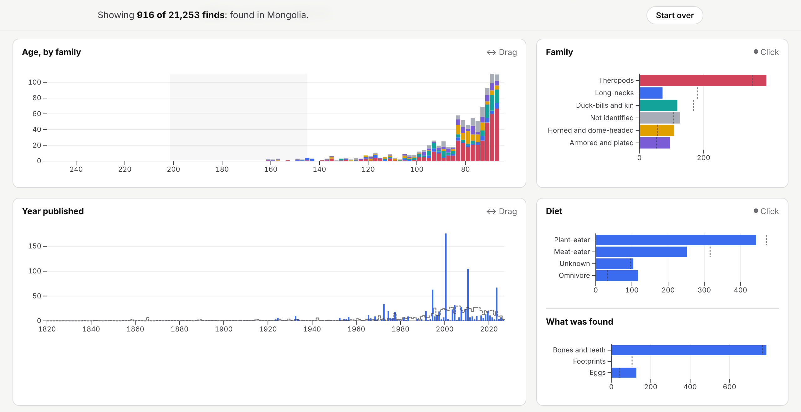

<p align="center">
  <picture>
    <source media="(prefers-color-scheme: dark)" srcset="assets/crossplot-wordmark-dark.svg" />
    
  </picture>
</p>

<p align="center">Cross-filtered charts for TypeScript, in the style of dc.js.</p>

---

Select a range in one chart and every linked chart updates to show only the matching rows. crossplot
provides a cross-filter engine and a shared filter store. Charts are drawn by separate renderer
packages. The first renderer uses [Observable Plot](https://observablehq.com/plot/).

> **Status:** 0.x on npm. The API can change between minor versions.

## Packages

| Package | What it is | Runtime dependencies |
| --- | --- | --- |
| [`@crossplot/core`](packages/core) | Headless engine, filter store and dashboard model. Optional plain-DOM count and table widgets under `@crossplot/core/dom`. | none |
| [`@crossplot/plot`](packages/plot) | Observable Plot renderer: histograms, bars, stacked and stream charts, share bars, bump charts, heatmaps and dot maps, with brushing and click selection. | peer: `@observablehq/plot` |
| [`@crossplot/react`](packages/react) | React hooks (`useDashboard`, `useChart`, `useFilters`, `useSummary`, `useRows`) and a `<Chart>` component. SSR and StrictMode safe. | peer: `react` >= 18 |
| [`@crossplot/vue`](packages/vue) | Vue 3 composables with the same names (`useDashboard`, `useChart`, `useFilters`, `useSummary`, `useRows`) returning shallow refs, and a `<Chart>` component. SSR safe. | peer: `vue` >= 3.3 |
| [`@crossplot/svelte`](packages/svelte) | Svelte 5 runes with the same names, returning reactive objects, and a `use:chart` action. SSR safe. | peer: `svelte` >= 5 |

Other renderers will be added later as separate packages.

## Example

```sh
npm install @crossplot/core @crossplot/plot @observablehq/plot
```

```ts
import { bin, count, createDashboard, lngLat, mean, top } from "@crossplot/core";
import { countDisplay } from "@crossplot/core/dom";
import { plotRenderer } from "@crossplot/plot";

const dash = await createDashboard({ data: meteorites, renderer: plotRenderer() });

dash.chart("#year", { dimension: bin("year", { step: 1, extent: [1800, 2026] }), value: count() });
dash.chart("#mass", { dimension: bin("mass", { scale: "log", bins: 40 }), view: { brush: "x" } });
dash.chart("#class", { dimension: top("recclass", 15), view: { mark: "barX", select: "multi" } });
dash.chart("#heat", { dimension: [bin("year", { step: 10 }), bin("mass", { scale: "log", bins: 20 })] });
// A world map: dots per 2° cell, brushable by longitude and latitude, with extra aggregates per cell.
dash.chart("#map", { dimension: lngLat("lng", "lat", { step: 2 }), extra: { mass: mean("mass") }, view: { mark: "map" } });
countDisplay(dash, "#total");

// Filter state is plain, observable and serializable.
dash.filters.set("recclass", { in: ["L6", "H5"] });
dash.filters.subscribe((snap) => saveToUrl(snap.toJSON()));
```

Each chart aggregates the rows that pass every filter except its own, the classic crossfilter
behaviour. Charts are plain spec objects: a dimension, an aggregate (`count`, `sum`, `mean`), optional
`extra` aggregates over the same bins, and a `view` that goes to the renderer untouched.

## How it works

- **Columnar table.** Rows are converted once into `Float64Array` columns and dictionary-encoded
  categories.
- **Binned dimensions.** Each chart's dimension is binned up front (linear, log, calendar or
  categorical, including top-N with "Other"), and row ids are counting-sorted by bin, then by value
  inside each bin.
- **Filter bitmask.** One bit per dimension per row. A filter change only visits rows between the
  old and new brush edges, and only rows whose bit flips touch the aggregates. Range filters
  compare raw values at the brush edges, independent of the bins. Changes that flip a large share of
  rows recount in sequential passes instead.
- **Prefix-sum tiles.** On large tables, dragging a brush on a binned chart switches to prefix sums
  over that chart's rows in value order (the approach of Falcon, Moritz et al. 2019):
  one pass builds them, then each frame costs a few lookups per bin of the other charts plus the
  rows at the brush edges, however far the brush moves. A box drag on a heatmap or map, or two
  range brushes moved in turn, uses 2-D summed-area tables over both axes once its frames get slow;
  groups with very many bins (a fine map grid) follow the brush row by row instead.
- **Worker.** The engine runs in a Web Worker by default (or on the main thread with
  `engine: "local"`); requests are coalesced to one per animation frame and stale results are
  dropped.
- **Renderers** implement a three-method contract (`mount`, `update`, `destroy`) and report intents
  such as "brushed x from 10 to 40" in data space. They never touch filters directly.

In a cloud dev container, `pnpm bench` measures brush-to-aggregates (engine only, 8 linked dimensions
including a heatmap and a 2° world map) at a median of about 0.3 to 2 ms per drag frame for 1M rows
and 3 to 12 ms for 10M rows, for range and box brushes alike. The first frame of a range drag, which
builds its tiles, takes about 0.1 s at 1M rows and 0.5 s at 10M. Box-brush tiles take about 2 s to
build at 10M rows, so they are built in slices of each frame and in idle time between frames while
the drag carries on incrementally (frames of about 40 to 100 ms), and take over after about 70 frames.

## Demo

The [demo](https://dotgap.github.io/crossplot/demo/) is a scrollable page of linked charts on real
fossil data. Drag or click any chart and the rest redraw for your selection.

[](https://dotgap.github.io/crossplot/demo/)

To run it locally (the source is in [`examples/dinosaurs`](examples/dinosaurs)):

```sh
pnpm install
pnpm demo
```

## Docs

The [docs site](docs) has a guide, live examples and an API reference generated from the TypeScript
types. Run it locally with:

```sh
pnpm docs
```

## Development

```sh
pnpm install
pnpm build       # build the packages
pnpm test        # vitest, including jsdom renderer tests
pnpm typecheck
pnpm bench       # engine brush latencies at 1M rows (pass a row count, or a list: 1e6,1e7)
```

See [CONTRIBUTING.md](CONTRIBUTING.md) for conventions, pull requests and releases, and
[SECURITY.md](SECURITY.md) to report a vulnerability.

## License

[MIT](LICENSE)
